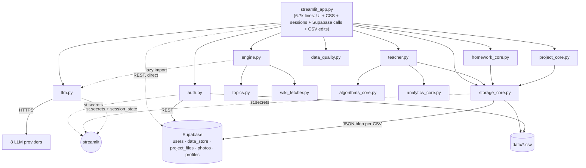

# Preluma — Phase 1 Code Audit

> Written **before** any code was changed. Baseline: the repository exactly as uploaded
> (`Preluma-edtech-main`, 45 files, ~11.6k lines of Python).

## 1. What the project is today

A Streamlit app for pre-class preparation at Yunnan University. Students run a 5-step
"Mission" (brief → examples → practice → mock test → overview), chat with an LLM tutor and do
homework. Teachers assign homework/projects and see class analytics built on hand-written
algorithms (merge sort, linear/binary search, mean/variance) — a **course constraint**: the
analytical core must use only the Python standard library (enforced by `test_no_pandas_in_core.py`).

## 2. Inventory

| File | Lines | Role |
|---|---:|---|
| `streamlit_app.py` | 6,695 | **Everything UI** + CSS (600 lines) + session tokens + Supabase photo/profile calls + some CSV writes |
| `engine.py` | 671 | Topic pack builder, question generator, grading, tutor-section lookup |
| `llm.py` | 555 | 8 provider callers, prompt construction, JSON parsing, topic detection |
| `homework_core.py` | 647 | Homework/submission/notification CSV store + grading |
| `auth.py` | 522 | Users, demo accounts, password hashing, Supabase REST + CSV, sessions |
| `project_core.py` | 427 | Project + file-upload store (Supabase blobs / local files) |
| `data_quality.py` | 400 | Self-check suite shown on the "Evidence Board" |
| `storage_core.py` | 326 | CSV persistence + Supabase key-value backup/restore |
| `topics.py` / `wiki_fetcher.py` | 270 / 211 | 29 curated topic packs / Wikipedia retrieval |
| `result_generator.py`, `teacher.py`, `models.py`, `algorithms_core.py`, `analytics_core.py` | 241/50/152/92/51 | Course-assessment algorithms and report |

`streamlit_app.py` holds 76 functions; the five largest (`student_profile_page` 472 lines,
`class_dashboard_page` 418, `my_homework_page` 380, `home_page` 316, `student_project_page` 259)
each mix rendering, data access and logic. 215 `unsafe_allow_html=True` calls.

## 3. Current architecture

Dependency facts that matter for migration:
* **Business logic imports Streamlit** (`auth`, `storage_core`, `llm`, `project_core` read `st.secrets`;
  `llm._log_error` writes `st.session_state`). A FastAPI backend could not import these as-is.
* `engine.py` (core) lazily imports `llm.py` (AI) — a core → infrastructure dependency.
* The UI file talks to Supabase directly (photos, profiles) and edits `homework.csv` itself
  (`class_dashboard_page`, ~line 6384).
* Three modules (`auth`, `storage_core`, `project_core`) each re-implement the same
  Supabase header/URL/secret helpers.

## 4. Data architecture

* **Storage is CSV files** under `data/`, with a Supabase "backup" that stores each whole CSV as one
  JSON string in `preluma_data_store(key, value)`; after a redeploy the file is restored from it.
* Consequences: every append rewrites/uploads the entire file; two concurrent writers
  silently overwrite each other (last-writer-wins); IDs come from `max(id)+1` (race-prone);
  no foreign keys, constraints or indexes; no way to query ("all weak topics of student X") without
  loading everything.
* Supabase tables referenced in code: `preluma_users`, `preluma_data_store`, `preluma_project_files`,
  `preluma_photos`, `preluma_profiles` (**5**; the README says 12 — I could not find the other 7 in code).
* Entities the vision needs and which **do not exist**: Course, Lesson, Enrollment, Progress,
  SkillProfile, Recommendation, Achievement, AI conversation history. Mission results are one flat row
  (`students.csv`); there is no per-student mastery history.

## 5. Authentication flow

1. `auth.authenticate()` first compares against `DEMO_USERS` held **in source code**, then the active backend.
2. Passwords: unsalted SHA-256.
3. "Remember me": an HMAC-signed token (`username, role, name, exp+30d`) placed in the **URL query
   string** (`?t=…`) and localStorage; a second, in-memory session id (`?sid=…`) as fallback.
4. Role checks happen in `main()` by comparing `page` to hard-coded sets; `_ADMIN_USERS` is a
   hard-coded set of usernames.

## 6. AI / LLM pipeline

`llm_tutor()` etc. → `_call_llm()` → loop over seven near-identical `_call_<provider>()` functions
(each swallows every exception and returns `""`) → JSON parse → fall back to curated text.
* No retrieval: the model answers from its own knowledge, not from course material.
* No conversation memory beyond the last 6 messages pasted into one prompt in the homework chat.
* Gemini API key is sent in the URL query string (ends up in logs/proxies).
* Seven of the eight providers are listed in the failover chain; Gemini is detected as "available" but
  never called by `_call_llm` (it is missing from the tuple) — the README's "8 providers" is really 7 in practice.
* Availability errors are invisible (no logging).

## 7. Student / teacher workflows

* **Student:** Mission (curated pack → LLM-or-static brief → 4 generated MCQs → mock test → result row appended to
  `students.csv`), Ask AI, My Homework (grade, log mistakes), Class Projects (upload).
  *Learning data is never fed back into anything*: weak skills are recorded but nothing recommends what to study next.
* **Teacher:** Teacher Studio (CSV table, merge-sort ranking, search, skill analytics, audit log),
  Homework Center, Class Dashboard, Project Center.

## 8. Security findings

| # | Severity | Finding |
|---|---|---|
| S1 | **Critical** | `reset_password(username, new_password)` needs **no proof of identity** — anyone can take over any account, including teachers/admins. |
| S2 | **Critical** | Real-looking credentials for 12 accounts (teachers named after real people, admin) are **hard-coded in `auth.py`** and therefore in git history. They must be treated as compromised and rotated. |
| S3 | High | Passwords hashed with **unsalted SHA-256** (fast, rainbow-table-able). |
| S4 | High | Session HMAC key is a **constant in source**; the `HMAC_SECRET` in `secrets.example.toml` is never read. Signature truncated to 24 hex chars. Token (30-day) lives in the URL → leaks through screenshots, referrers, shared links, browser history. Role is trusted from the token. |
| S5 | High | Teacher self-registration invite code falls back to a **public default** (`PRELUMA-TEACH-2024`, also printed in the example secrets file) and is compared with `!=` (not constant-time). |
| S6 | High | `project_core` docs prescribe an RLS policy `for all using (true)` — with the anon key that makes **every table, including password hashes, world-readable/writable**. |
| S7 | Medium | PostgREST filter built by string interpolation: `…?username=eq.{uname}`, `project_id=eq.{project_id}` — no validation/encoding. |
| S8 | Medium | User-controlled strings (full name, student name, homework title…) are interpolated into HTML passed with `unsafe_allow_html=True` (e.g. `student_profile_page`, `class_dashboard_page`) → HTML/CSS injection into other users' pages (e.g. a student named `<h1>…` on the teacher dashboard). Streamlit strips `<script>`, but this must not be relied on. |
| S9 | Medium | Uploads: extension allow-list only; no content check, original filename used in local path (sanitised), 100 MB limit stored as base64 in a DB column. |
| S10 | Low | Silent `except Exception: pass` in most network code hides failures and attacks. |
| S11 | Low | `result.txt` (generated) and two different `secrets.example.toml` files are committed; `data/` is git-ignored (good). |

## 9. Code-quality findings

* God file (`streamlit_app.py`); functions of 200–470 lines; module-level side effects (`CAMPUS_URI = image_data_uri(...)` at import).
* Copy-paste: seven provider callers differ only in URL/headers; `_get_secret`, `_now`, `_new_id`, Supabase helpers repeated 3–4×.
* Type hints partially present; docstrings good in the "core" files (well documented) but absent in the UI file.
* Naming/behaviour surprises: `create_homework()` returns `(id, id)` "for backward compatibility".
* Dead / misleading: `build_teacher_dataframe` returns a list, not a DataFrame; `learning_mode` is documented as "Guided/Quick" but the app writes "Deep Understanding" etc.

## 10. Test suite baseline (before changes)

`pytest` → **30 passed, 6 failed**. None of the 6 are product bugs:

| Failing test | Cause |
|---|---|
| `test_homework_end_to_end` | Test passes the `(id, id)` **tuple** returned by `create_homework()` into `submit_homework()` — questions are never found. |
| 3 × `test_runtime_streamlit` | `AppTest.from_file("streamlit_app.py")` resolves relative to `tests/` → file not found. |
| 2 × `test_v25_unique_design` | Tests grep the *source text* of `streamlit_app.py` for emoji/CSS strings — brittle; a changed string or a moved function breaks them. |

Coverage gaps: no tests for `auth`, `llm` routing, `project_core`, storage back-ends.

## 11. Strengths (worth preserving)

* Clear, well-commented core modules; hand-written algorithms with timing, meeting the course brief.
* Resilient multi-provider failover and curated-content fallback: the app works with zero API keys.
* Graceful degradation everywhere (Supabase → CSV; LLM → curated pack; Wikipedia → generic pack).
* Rich, cohesive UI with a recognisable identity; guided Mission flow is a good learning design.
* Question generator balances four skill categories and randomises distractors.

## 12. Weaknesses, technical debt, scalability limits

* **Architecture:** UI, logic and persistence are tangled; no seams for an API layer.
* **Persistence:** CSV+blob cannot support concurrent users, analytics queries or relational integrity; `max(id)+1`.
* **Scalability:** every request re-reads whole CSVs; `ensure_data_files()` is called on every read; Supabase calls are
  synchronous inside the Streamlit rerun loop (8–30 s timeouts block the UI).
* **AI:** no grounding in course material, no memory, no evaluation.
* **Personalisation:** none yet — the platform records results but never uses them.

## 13. Recommended changes (what this refactor implements)

1. New layered layout: `core/` (pure logic) · `services/` · `database/` (SQLAlchemy models + repositories) ·
   `ai/` (router, embeddings, vector store, RAG, memory) · `auth/` · `components/` · `views/` · `tests/`.
2. Business logic must not import Streamlit. A single bootstrap copies `st.secrets` into environment variables; everything
   else reads a plain `Settings` object.
3. Keep every legacy module importable as a thin re-export so existing behaviour and tests keep working while the UI is migrated.
4. Relational schema (Users, Courses, Lessons, Enrollments, Progress, QuizAttempts, SkillProfile, AIConversationHistory,
   Recommendations, Achievements) behind the repository pattern; SQLite by default, PostgreSQL/Supabase via `DATABASE_URL`.
5. RAG over the 29 topic packs + uploaded course material, working fully offline (pure-Python embeddings) and upgradeable to
   Sentence-Transformers/FAISS/ChromaDB.
6. Personalisation: mastery tracking, weak-topic detection, learning speed, learning-style inference, learning-path generator.
7. Security: PBKDF2 salted hashes with transparent upgrade of legacy hashes; no secrets in source; proof-required password reset;
   signed, expiring, revocable sessions; validated inputs; HTML-escaping of user data.
8. Repair the stale tests and add `test_auth/database/ai/recommendation/learning_engine`.

### Constraints I will respect

* `pandas`/`numpy` stay out of the course "core" (the existing guard test is extended to the new `core/` package).
* `pages/` is **not** used as a folder name: Streamlit auto-registers any `pages/` directory next to the entry script as public routes,
  which would let visitors open dashboards without passing the login gate. The same role is played by `views/`.
* The deployed entry point `streamlit_app.py` stays (Streamlit Cloud points at it); it becomes a three-line shim around `app.py`.

---

## Addendum — findings made during the refactor

* `core/topics.py` (originally `topics.py`) defined the key `"cloud computing"` **twice**; Python silently kept the second
  dictionary entry, so the first (shadowed) pack was dead code and the library holds **28** distinct topics, not 29 as the
  README, hero banner and home page claimed. The duplicate was removed and the UI now shows `len(TOPICS)`.
* Two tests were asserting on the *source text* of `streamlit_app.py`; they broke as soon as the UI was split into modules.
  They now read the concatenated UI sources through `tests/helpers.app_source()`.
* The original runtime tests started the app without logging in, so they had been silently failing behind the login gate;
  they now start a signed-in session.
* `homework_core.create_homework()` returns `(id, number)` although a test treated it as a single id — the test was fixed, the API kept.
* A generated `result.txt` and two different `secrets.example.toml` files were committed; both are gone (`result.txt` is git-ignored, one example file remains).
